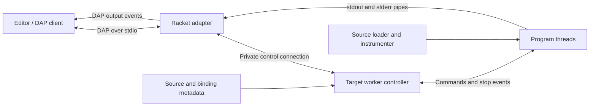

# Racketeer design

Status: architecture and acceptance plan, 2026-09-27. An initial DAP adapter and
installable VS Code extension are implemented, including expression stepping,
conditional breakpoints, uncaught exception stops, live lexical evaluation,
cooperative cancellation, interactive sessions, terminal line input, and a
separate target worker. Racketeer packages these with language-server editing
support, syntax highlighting, run/test tasks, and a normal Racket REPL in one
extension. The delivery gates below
remain the acceptance plan, not a statement that all behavior is supported.
See [README.md](README.md) for the implemented release and its limits.

## 1. Product decision

Build a Racket debugger with a DAP interface. The primary experience is debugging
ordinary Racket libraries, tests, and command-line programs, then interacting
with those programs in a Racket console. GUI programs and language development
should fit the architecture, with their support established in later milestones.

The unit of attention is an **expression and its values**. The environment is a
set of **lexical bindings in a module**. The stack describes **current control
context**, including Racket's tail-call and continuation semantics.

The initial implementation should be entirely in Racket. Editor extensions
register the adapter and provide launch configuration; the debugger must work
without an editor-specific runtime or a graphical Racket installation.

### What a session should feel like

Consider:

```racket
#lang racket

(define (price subtotal rate)
  (define tax (* subtotal rate))
  (values (+ subtotal tax) tax))

(module+ main
  (define-values (total tax) (price 100 1/10))
  (displayln total))
```

At `(* subtotal rate)`, the editor highlights the expression and presents
`subtotal = 100` and `rate = 1/10`. Stepping over it exposes the result `10`.
The console evaluates `(+ subtotal 20)` to `120` in the selected lexical frame.
At a non-tail caller's return boundary, the two returned values appear as two
values, `110` and `10`, rather than being mistaken for a single list.

A tail call replaces its caller's control context. A tail-recursive loop must
remain bounded in control-stack space while debugging. A promise stays unforced
when expanded in the variables view. An opaque structure remains opaque unless
the applicable inspector permits access.

## 2. User-facing contract

### Expressions, breakpoints, and results

- Breakpoints refer to executable expression entries, with source ranges and
  optional columns. A breakpoint on a definition binds to an executable part
  of that definition, with its actual location returned to the editor.
- For a line-only request, prefer the outermost visible expression beginning
  on that line; otherwise choose the next visible expression entry in the same
  enclosing source form. If none exists, return an unverified breakpoint with
  an explanation. Never silently move into a different function.
- Before a module is instrumented, its breakpoints are pending. Emit breakpoint
  change events when their locations become known. `breakpointLocations` uses
  the same executable-site table as `setBreakpoints`.
- Ordinary stepping stops before visible expressions. Step Over can also stop
  at an expression's completion and show its returned values. The stop
  description distinguishes “before expression” from “expression returned.”
- Return values have a dedicated `Return values` scope with a count. Zero values, one `#<void>` value,
  and several values are distinct. A result is retained only for the relevant
  stop; there is no implicit unbounded evaluation history.
- Conditional breakpoints evaluate Racket expressions in the stopped lexical
  environment: only `#f` is false. Hit counts are maintained separately from
  conditions. Conditions and logpoint expressions can execute program code;
  their effects are real. A condition error stops with a useful diagnostic.

Expression stepping maps to DAP's `statement` granularity; line stepping is an
additional mode. DAP has no `expression` granularity. Instruction stepping is
not advertised. Use ordinary stack-frame ranges, variables, scopes, and stop
descriptions so the basic experience survives clients with limited range UI.
These mappings must follow the [DAP schema](https://raw.githubusercontent.com/microsoft/debug-adapter-protocol/main/debugAdapterProtocol.json).

### A Racket console

Two related modes share one implementation:

1. **Paused evaluation:** evaluate in a selected frame's lexical environment
   and module namespace. Live local values and shadowing must be correct.
2. **Interactive session:** after loading a module, retain its namespace so
   the user can call its functions from the debug console. Those calls can hit
   breakpoints. Finishing one interaction leaves the session ready for another.

The default script session ends according to its documented runner lifecycle.
Interactive mode is explicit. The console's reader and expression language are
Racket initially; supporting a custom language's interaction reader requires
separate integration. Do not assume every `#lang` provides a Racket REPL.

### Modules and languages

Launch supports the usual module entry point and explicit submodules such as
`main` and `test`. Instrument selected source files across module boundaries.
Collection dependencies run normally unless selected for debugging.

The first supported languages are `racket/base` and `racket`. Common macros such
as `for`, `match`, and `class` require compatibility fixtures. Other languages,
including Typed Racket and custom `#lang` implementations, gain support through
tested expansion and source-location behavior, not through a blanket claim that
all languages work because they expand to Racket.

Runtime debugging of macro-generated code belongs in the core. Debugging a
macro transformer while it expands code is a separate, phase-aware feature.

## 3. Architecture and ownership

The adapter, language tools, and VS Code integration share a repository, but
have separate responsibilities. `racketdap/` runs independently of `vscode/`
and the bundled language server. Stepping, live values, and execution results
belong to the adapter. Workspace references and rename belong to language
analysis. VS Code owns commands, editor views, and presentation of those results.
Language analysis must not become a prerequisite for launching or controlling
a debug session.

Keep the adapter's stdio DAP entry point usable by other clients. Any optional
client-specific metadata must leave ordinary DAP operations usable without it.
The protocol session regression runs a standalone copy of `racketdap/`, without
the extension, bundled server, user package links, or repository working directory.

The adapter will move to its own repository and independently versioned Racket
package. Keep its runtime, instrumentation, and protocol tests together. Editor
commands, language analysis, and presentation remain with the extension. The
extension should bundle a pinned adapter release so users still install one
extension. Launch options and optional protocol extensions belong to the
adapter's documented public contract.

Until extraction, enforce the same dependency boundary in this repository and
retain the standalone protocol regression. The split should change packaging
and release ownership without changing debugger behavior.



**Adapter process:** owns DAP transport, request sequencing, session state,
breakpoint requests, source presentation, and translation of worker events.
It never evaluates user Racket code. A single session owner serializes state
changes; output sequence numbers are allocated inside the output serializer.
Slow evaluations must not prevent the adapter from receiving termination or
cancellation requests.

**Worker process:** uses the selected Racket installation and owns the program's
namespace, module instances, instrumentation, threads, live values, and
evaluation. Its controller stays outside the program's custodian. Target code
runs under a dedicated custodian. There is one worker per launch.

Use an ephemeral loopback TCP connection for private control traffic. The worker
authenticates with a one-use token delivered through its bootstrap stdin pipe;
the adapter then closes that bootstrap stream. Bind only to loopback and close
the listener after the expected worker connects. The control protocol is
versioned, framed JSON containing metadata and opaque handles, never arbitrary
Racket values. It is an implementation boundary, not a public network service.

Program stdout and stderr have their own captured pipes. Program stdin is
explicitly configured independently: EOF by default, or a file/terminal supplied
by the runner. DAP's debug console is for evaluation, not implicit program stdin.
Interactive terminal support can use a small launcher and DAP `runInTerminal`
without changing the control protocol; it is a later milestone. A worker exit,
`(exit)`, or native crash must leave the adapter able to report termination.
A worker that ends without reporting a program exit, such as one the system
kills when memory runs out, is named in the Debug Console with its exit code or
signal before the session terminates.

Termination requests a cooperative shutdown, closes program resources through
the custodian, then uses a bounded OS-process fallback. Owned child-process
cleanup requires platform tests; deliberately detached processes are outside
the initial guarantee. A restart creates a fresh worker and namespace. It does
not attempt to unload and redefine an existing module graph.

### Small implementation boundaries

Proposed layout, to be introduced as each responsibility is implemented:

```text
info.rkt                       package and raco command registration
racketdap/main.rkt             adapter entry point
racketdap/protocol.rkt         DAP byte framing and serialized messages
racketdap/session.rkt          adapter state and request dispatch
racketdap/source.rkt           source identity, ranges, breakpoint resolution
racketdap/worker/main.rkt       bootstrap, runner, private control protocol
racketdap/worker/load.rkt       namespace and module-loading integration
racketdap/worker/instrument.rkt component compatibility exports
racketdap/instrumentation/instrument.rkt expanded-syntax instrumentation
racketdap/instrumentation/runtime.rkt binding accessors and continuation metadata
racketdap/worker/control.rkt    stops, stepping, threads, handle lifetimes
racketdap/worker/evaluate.rkt   frame evaluation and explicit mutation
racketdap/worker/inspect.rkt    bounded value previews and children
tests/                         semantic fixtures and protocol sessions
```

Use explicit structs and narrow module interfaces. Do not add a general
debugger-backend plugin framework, a second expression interpreter, or an
editor-specific core. Introduce further abstractions when a second concrete
use requires them.

### Workspace analysis boundaries

Workspace analysis runs in a separate service with three ownership boundaries:

| Layer | Responsibility |
| --- | --- |
| `vscode/workspace-index.js` | Observe VS Code document lifetimes, settings and file events; submit source views; convert results to editor locations and edit previews. |
| `vscode/workspace-index.rkt` | Frame private requests, map request IDs and cancellation messages, translate domain outcomes, and close the engine when the connection ends. |
| `vscode/workspace-analysis.rkt` and `vscode/workspace-rename.rkt` | Discover files, analyse immutable source views, combine binding references, validate rename, and own bounded worker places. |

The engine has no editor connection, request IDs or wire-protocol errors.
`make-workspace-analysis` creates an independent instance. Its optional
`#:on-status` callback receives progress records; it is an output sink and must
not re-enter the engine. Instances have separate runs, locks and worker slots.

`workspace-analysis-update!` accepts a complete immutable snapshot containing
`revision`, `roots`, `documents` and optional `settings`. Each document has a
file or untitled URI, an opaque lifetime identity, a version and its text. Revisions increase
within one instance. The adapter owns incremental changes and assigns a new
identity when a document closes and reopens. The optional `documentsOnly` hint
permits reuse only after the engine verifies the new source view against disk.
Untitled source identities and import bases belong to the analysis snapshot.
The engine creates no placeholder source files; returned locations retain the
original document URI.

`workspace-analysis-query` accepts `references`, `prepare-rename` or `rename`,
the source URI and position, and an optional cancellation event. Ordinary
requests identify the document lifetime and version; captured-source reference
requests instead supply the captured text. Results are `AnalysisResult` values
containing the accepted revision and value, or `AnalysisFailure` values with a
symbolic reason and message. Adapters choose their protocol's representation.

`workspace-analysis-close!` is idempotent. It cancels active runs, waits for
their completion and reaps worker places. Further updates have no effect;
queries return a closed-engine outcome. Closing one instance leaves other
instances usable.

An LSP host can use the same engine by constructing snapshots from its document
registry and mapping standard reference and rename requests to the query API.
VS Code document events, commands, status presentation and edit application
remain editor responsibilities. That integration changes the adapters while
retaining the analysis and rename implementation.

## 4. Instrumentation and module loading

### Implemented core

The [component design](racketdap/instrumentation/DESIGN.md) describes expression
instrumentation, live binding access, and evaluation. The loader selects and
expands modules; the component instruments runtime forms and reports stops
through one event callback. Worker code implements debugger policy using that API.

### Loading pipeline

For selected source modules:

```text
read-syntax -> expansion in the intended namespace and phase
            -> source/binding metadata + instrumentation
            -> compile/evaluate in the target worker
```

Use Racket's loader/compiler hooks; preserve resolved module identities,
relative loading paths, submodule identities, readers, and phase instances.
Selected modules must bypass ordinary cached bytecode when source instrumentation
is required. Leave unselected modules on the ordinary loading path. Debug builds
never overwrite the project's normal `.zo` cache; see
[Compiled instrumented code](#compiled-instrumented-code). The hook behavior is specified by Racket's
[evaluation and compilation reference](https://docs.racket-lang.org/reference/eval.html).

An implementation must not expand a module once to discover breakpoints and then
expand it again to run it. Expansion can execute code. Compared with an ordinary
source load, instrumentation must not duplicate transformer effects or module
instantiation. Source discovery before launch is limited to reading; verified
breakpoints come from the actual load. Cache-miss source expansion itself can
have effects that a cached ordinary run avoids.

By default, instrument project sources under the configured source roots. A
breakpoint in an additional file can select it before that module loads. If it
is already loaded uninstrumented, explain that a restart is required. Always
exclude the debugger implementation and its control machinery.

If an expanded form cannot be safely instrumented, report the unsupported
module/form. Do not claim verified breakpoints in code that was skipped.

### Compiled instrumented code

A launched debug session keeps instrumented compiled code in the extension's global
storage, or `racketeer/debug-cache` in Racket's addon directory when no client names
a folder. `racketdap.debug.compiledCache` and the `debugCache` launch attribute turn
it off. Nothing goes beside sources. `racketdap/worker/debug-cache.rkt` owns the
location, key and limits; `racketdap/worker/load.rkt` owns its use.

Generated code holds no session state (see the
[instrumentation design](racketdap/instrumentation/DESIGN.md)). An uncached
run and a cached run execute the same code, and compiled code is read back with the
session's site IDs and callbacks supplied by a table.

The compilation manager decides what is current, as `raco make` does for errortrace
through `current-compile`. It runs in the target namespace from the load handler, so
a file expands once, with its effects where they would be without the cache. It writes
under a root of its own, one directory per Racket version, VM, target machine,
library paths and links, and instrumenter files and location. Its modes separate
debugging from coverage code. A file the debugger does not select but which has no
ordinary compiled file gets a plain entry, so its own dependencies are tracked.
A file with an ordinary compiled file is reported to the manager by that file's hashes,
so selecting or deselecting a library rebuilds what was compiled against it.

The manager believes a file whose date is no newer than its compiled file, and a
rebuild of a dependency within the same second goes unseen. Each selected file's entry is
given the oldest date before the check, which sends it to the comparison of source and
dependency hashes, registered non-module files included.

The record an expansion leaves is compiled into the `.zo` as a submodule, so code and
sites change in one atomic rename, and is taken out again before the program is declared.
It holds the hash of the bytes compiled and, in expansion order, each form's module path
and sites, each language wrapper, and each selected file loaded. Replaying it gives
the session the same announcements in the same order as expanding, declares files only
a submodule or macro needed, and registers the callbacks. A rebuild of some files
checks dependencies first, so their announcement order and source reference numbers
can differ on that run; nothing else does. A file a module loads only through an
already declared one is declared when it is needed, not at replay.

The saved source hash is compared with the file read for this run before the code is
declared. The manager can also record a hash of a file saved while it compiled older
bytes; such an entry is dropped when the build ends. A `.zo` that fails its embedded
hashes is deleted and read from source. Anything raised while building turns the cache
off for the session and loads from source, dropping output of the failed attempt so a
syntax error reads as it does without the cache; expansion effects other than output
happen twice in that case. Module code that a `.zo` cannot hold, such as a
macro embedding a closure, stays uncached the same way on each run.

Concurrent sessions rely on the manager's atomic renames. Both may build; a mismatch
of dependency hashes then causes one more rebuild, never a wrong read. At session start,
the least recently used entries go when the folder exceeds 512 MB. Deleting the folder
is always safe, so there is no clear command. Test runs, coverage runs, plain-file
languages and attached hosts run from source.

A hit expands nothing, like any compiled module: a macro's effects and any input it read
without registering it (`register-external-file`, `include` does) are not repeated. That
is the same contract as `raco make`.

### Semantic obligations

Instrumentation must preserve evaluation order, multiple-value arity, mutation,
exception propagation, proper tail recursion, continuation behavior, and
`dynamic-wind` effects, except for deliberate debugger pauses and evaluations.
Instrumentation changes timing, allocation, and optimization; it is not
observationally invisible to code that inspects its own execution.

Use private continuation marks for debugger context. Do not retain every tail
caller, wrap every expression in a new `dynamic-wind`, or introduce continuation
barriers around ordinary target execution. Racket permits continuation capture
and invocation across nontrivial dynamic contexts, including invocation from
another thread; a debugger must not silently reduce that model to a linear call
history. See [continuations](https://docs.racket-lang.org/reference/cont.html)
and [continuation marks](https://docs.racket-lang.org/reference/contmarks.html).

Getter closures retain accessible lexical bindings. For ordinary assignable
lexical variables, generate setters and accept the associated debug-build
optimization cost. For module bindings, provide setters only when the expanded
program already establishes their mutability. Imported bindings and module
constants remain read-only. The new core uses binding-preserving aliases for
module evaluation. Test binding behavior as well as values;
do not make every module binding mutable merely for editor convenience.

## 5. Source and runtime model

Keep these identities separate:

| Object | Identity and purpose |
| --- | --- |
| Source | Canonical source identifier, captured content, digest, coordinate map |
| Module instance | Resolved module path, submodule path, phase, namespace instance |
| Static site | Module/source identity, expanded occurrence, expression range, boundary kind, tail-position metadata |
| Binding | Lexical binding identity, source name, visibility, getter, optional setter |
| Dynamic context | Fresh token for a live activation or return context, carried by continuation marks |
| Stop | Session, thread, stop generation, event sequence, site, reason, context, optional returned values |
| Value handle | Opaque ID owned by a valid stop/evaluation result, resolving to a worker-side value |

A source offset is not a site ID. Macro expansion can produce several executable
occurrences with the same source range. A procedure name is not a binding ID.
Recursion can revisit one site under several different dynamic contexts.

The source store captures the text actually loaded. If the disk changes, retain
that version for display through DAP `sourceReference` and explain that restarting
is needed to debug the edit. Do not relocate a live breakpoint against new text
and present it as the running version.

Translate source coordinates from the captured text. Racket's counted port
positions treat CRLF as one position and expand tabs in its column count; DAP
columns count UTF-16 code units. Honor the client's zero/one-based preferences.
Tests must include tabs, CRLF, non-BMP characters, and non-ASCII paths. See
[Racket position counting](https://docs.racket-lang.org/reference/linecol.html)
and the [DAP schema](https://raw.githubusercontent.com/microsoft/debug-adapter-protocol/main/debugAdapterProtocol.json).

### Source view and macros

The default source view favors expressions written by the programmer and hides
debugger machinery. Preserve original syntax locations and useful expansion
origin information; use them as evidence, not as a guaranteed reversible source
map. Missing or ambiguous origin data must remain visible as a limitation.

An optional expanded runtime view can expose generated expressions in a read-only
virtual source. Preserve a mapping from each generated display node to its
instrumented site. It is not a macro-expansion stepper. Local syntax bindings
that disappear during expansion do not automatically become runtime variables.
Racket documents these distinctions through its
[syntax properties](https://docs.racket-lang.org/reference/stxprops.html).

## 6. Stepping and stack semantics

The stack is reconstructed from the current stop and the debugger's continuation
marks. Name frames using source procedure names when available, falling back to
`lambda` plus a source location. Module/phase identity is available as metadata.
Uninstrumented regions may contribute labeled source context, but must not
pretend to expose live lexical frames.

No synthetic history of eliminated tail callers appears as live stack frames.
An optional bounded history feature could be added later as a separate view.

### Proposed step controller

Each step command records its starting event sequence and dynamic return/context
identity. This is separate from persistent user breakpoints. The algorithm must
be proved by the semantic fixtures before its interface is treated as stable.

| Command | Intended behavior |
| --- | --- |
| Step In | Stop at the next visible expression event, including entry to an instrumented callee. |
| Step Over | At a non-tail expression entry, run to that occurrence's completion, or a user breakpoint/exception/control transfer encountered first. |
| Step Out | Run to the selected active computation's enclosing return context, or an intervening breakpoint/exception/control transfer. |
| Continue | Run until a user breakpoint, requested pause, supported exception stop, or session completion. |

For a tail expression there is no separate local return boundary. Step Over
follows the enclosing return context instead; it may reach the caller, finish
the interaction, or finish the program. Explain this in the stop description.
Do not synthesize an after-hook that destroys tail position just to make the
button look uniform.

When a continuation abandons a step target, stop at the first visible event
outside that target context and describe the control transfer. A re-entered
continuation carries its context tokens, but the next event must still be newer
than the step command. A continuation invoked from another thread participates
in that thread's execution; it does not inherit another thread's step command.
Temporary stepping state is removed on completion, cancellation, or termination.

Line stepping coalesces expression events only within the current execution of
a line. Revisiting the same line in a loop or recursion is progress. Do not
implement it as “ignore every event with the previous line number.”

User breakpoints take priority over step coalescing. Source filtering affects
visible stops, not the correctness of dynamic return/context tracking.

## 7. Lexical evaluation and value inspection

### Frame evaluation

`eval` alone cannot see a paused function's local bindings. The worker needs a
lexical bridge: capture binding accessors at instrumentation time, resolve the
selected frame's visible bindings by identity and shadowing, then introduce
those bindings around the console expression in its module namespace. Racket's
[guide to eval](https://docs.racket-lang.org/guide/eval.html) explains the lexical
limitation.

The proposed bridge uses generated identifier aliases backed by getters and,
where supported, assignment transformers backed by setters. It must support
identifier use, procedure application, and `set!`, and must not make assignments
to a copied local value appear to mutate the program. Assignment-transformer
support is documented in the
[syntax transformer reference](https://docs.racket-lang.org/reference/stxtrans.html).

Prove this bridge with shadowing, source macros, imported names, private module
bindings, escaped closures, and mutation before promising general console
evaluation. Initially available macros are those accessible in the module
evaluation context. A vanished `let-syntax` transformer or syntax-parameter
context is not reconstructed automatically; unsupported local expansion context
must produce an honest limitation rather than misleading evaluation.

Execute paused evaluation on the paused program thread, preserving its dynamic
context. Selecting an older frame selects that frame's lexical environment; it
does not magically restore that caller's historical parameterization. Document
that dynamic parameters come from the pause site.

During paused evaluation, suppress recursive debugger hooks and isolate the
debugger command loop from escaping continuations. Any continuation barrier is
local to debugger-requested evaluation. Ordinary program execution remains
unrestricted. A running interactive-console call, by contrast, executes as a
normal debuggable interaction and may stop at breakpoints.

Hover is binding lookup and structural preview only. Watches are explicit Racket
expressions evaluated at stops and can have side effects. Console evaluation,
conditions, and logpoints can also perform I/O, mutate state, block, or raise.
Use cooperative cancellation; there is no rollback guarantee. An unresponsive
evaluation cannot be made safely resumable merely by killing the paused program
thread. The adapter must remain responsive enough to terminate the worker.

### Racket values

| Value | Default presentation |
| --- | --- |
| Numbers | Racket notation preserving exactness, rationals, and complex values |
| Symbols, keywords, strings, bytes, characters | Bounded Racket notation with their actual type |
| Pairs and lists | Bounded sequence preview; expandable `car`/`cdr` preserves improper or cyclic shape |
| Vectors, boxes, hashes | Bounded contents previews; lazy children with indexing/entry paging and mutability information |
| Structures | Bounded type/field preview where permitted; numbered expandable fields |
| Procedures | Name when available without program callbacks; expandable arity, without an invented list of closure captures |
| Syntax objects | Bounded datum preview; expandable datum and source coordinates |
| Promises, ports, threads, continuations | Descriptive handles; no implicit forcing, reading, execution, or resumption |
| Uninitialized/unavailable bindings | Explicit unavailable state, distinct from `#f` and `#<void>` |

Implement a bounded structural renderer. Default preview must not call arbitrary
custom writers, force promises, or invoke object methods. Treat impersonated or
chaperoned values conservatively where reading children could execute user code.
Offer explicit console operations for users who want those effects. Respect
[structure inspectors](https://docs.racket-lang.org/reference/inspectors.html):
use the target pause site's inspection authority, not a more privileged
controller inspector, for automatic previews.

Limits apply to depth, visited nodes, output length, and requested child count.
Avoid walking an entire list or hash merely to populate a count field. Preserve
sharing and detect cycles using identity. Numeric display strings must not pass
through JSON's numeric representation.

Live values remain in the worker. The adapter sees opaque handles and summaries.
Release debugger-owned strong references on resume or session end; invalidate
references conservatively when any resume makes their stop context stale.
Mutation invalidates affected previews. Repeated requests for expired handles
return a clear stale-reference response, never data from a newer stop.

## 8. Threads, exceptions, and lifecycle

### Threads

Track actual program threads as they enter instrumentation, with stable IDs and
per-thread stop state. Report the discovery boundary: foreign code, futures,
and places are not automatically inspectable Racket-thread frames.

The default stop suspends the triggering thread at a cooperative instrumentation
point. Other threads can continue. Report `allThreadsStopped: false`; shared
objects may consequently change during inspection. Several threads can have
independent pending stops, serialized into DAP events by the adapter.

Implement Pause as a cooperative request acknowledged at a safe point. Blocking
or native code may delay acknowledgment; do not report it stopped prematurely.
Do not use arbitrary suspension of threads holding runtime or application locks
as a shortcut to an “all stopped” claim. A later pause-all operation requires
individual acknowledgments and keeps the controller runnable.

Only advertise single-thread execution capabilities once continue/step semantics
have been tested with several stopped threads. Places, futures, GUI eventspaces,
and native/FFI execution need explicit support boundaries and later fixtures.

### Exceptions

The first exception filter is **uncaught**. Preserve normal Racket handler and
exit behavior after inspection. A stopped uncaught exception is not a promise
that Continue can resume the failed expression; Continue allows error handling
and termination to finish.

Use an exception's recorded continuation marks when available, and label that
context honestly. The marks can describe exception construction rather than
the eventual raise site. A raised value need not be an `exn` structure. Values
read through retained accessors are not historical snapshots of arbitrary heap
state. See the [exception reference](https://docs.racket-lang.org/reference/exns.html).

Breaking on every raise, caught exceptions, and RackUnit check failures requires
separate hooks and tests. Running a `test` submodule alone does not provide a
“break on test failure” implementation. Errortrace may supplement source
diagnostics but is not the interactive debugger backend.

### Session states

```text
adapter: new -> initialized -> configuring -> active -> terminating -> ended
worker:  booting -> loading -> running / interactive-ready -> exiting
thread:  running -> pause-requested -> stopped -> evaluating / running -> ended
```

The active session can contain several running and stopped threads. It is not
one global paused boolean. Request dispatch checks state and stop generation.
Worker EOF, protocol failure, cancellation, and repeated terminate/disconnect
requests converge on one cleanup path and at most one DAP terminated event.

Create the worker and apply configuration before starting target module load.
Send DAP `initialized` when configuration requests can be accepted; complete
`launch` without a circular dependency on `configurationDone`. Begin the target
load only after configuration is complete. Expansion/load errors are reported
through the same output and termination path.

## 9. Launch and DAP surface

Proposed configuration for a thin editor integration:

```json
{
  "type": "racket",
  "request": "launch",
  "name": "Debug Racket file",
  "program": "${file}",
  "cwd": "${workspaceFolder}",
  "args": [],
  "session": "script",
  "stopOnEntry": false
}
```

The executable defaults to `racket` on PATH, with a `racketExecutable` override.
Use the corresponding installation for the worker and reject an incompatible
worker protocol/version explicitly. Other optional settings should be limited
to concrete needs: environment overrides, source roots/additional debug paths,
program input, and an explicit submodule path.

With no `submodule`, use command-line-style entry: instantiate the root module
and invoke its `main` submodule once if present. `"submodule": ["test"]` selects
the test submodule without invoking `main`. `"submodule": []` loads only the root
module. Test these rules against Racket's runner behavior. Launching a test
submodule is not a claim to reproduce every `raco test` option or isolation mode.

An interactive session keeps its runner available after the entry action. When
ready, the console uses the entry module's namespace; while stopped it uses
the selected lexical frame. For a library, root-only loading plus interactive
mode is the natural starting configuration.

Initial DAP surface, enabled as implementation milestones pass:

- Initialize, launch, configurationDone, disconnect, terminate.
- SetBreakpoints, breakpointLocations, setExceptionBreakpoints.
- Threads, stackTrace, scopes, variables, source, loadedSources.
- Continue, next, stepIn, stepOut, cooperative pause.
- Evaluate, cancel; setVariable only for explicitly supported writable bindings.
- Output, breakpoint, stopped, continued, thread, exited, and terminated events
  where the corresponding lifecycle actually occurs.

Capabilities describe implemented behavior. Do not advertise restartFrame,
reverse execution, native disassembly, data breakpoints, or arbitrary-process
attach. In particular, attaching to an already optimized process does not
retroactively install lexical accessors and source instrumentation.

## 10. Delivery sequence and proof gates

### Gate A: semantics before protocol breadth

Create a headless instrumentation harness that runs fixture programs both
normally and instrumented, comparing results and deliberate effects. Keep
manual debugger evaluations out of equivalence comparisons. Prove:

- Proper tail recursion has bounded debugger context retention; multiple values
  and `begin0` preserve arity, results, and effect order.
- Non-tail recursion and same-source macro occurrences remain distinguishable.
- `call/cc`, composable/delimited continuations, re-entry, cross-thread invocation,
  and `dynamic-wind` preserve behavior and implement the proposed step policy.
- Modules, submodules, phase-shifted imports, and transformer effects are not
  accidentally loaded or expanded twice by instrumentation.
- Frame evaluation resolves lexical shadowing and module names; supported
  assignment reaches the real binding; unavailable lexical syntax is diagnosed.

If a proposed step-token or evaluation-bridge mechanism fails these cases,
change that mechanism before building the rest of the server around it.

### Gate B: one complete editor session

Implement one subprocess path: initialize, launch a small module, verify a
breakpoint, stop, inspect locals and returned values, evaluate an expression,
continue, and terminate. Cover byte-count framing, split messages, Unicode,
stderr/stdout separation, worker crashes, and cleanup. Exercise a real DAP
client as well as a protocol harness.

### Gate C: useful daily Racket debugging

Finish expression/line stepping, multiple source files, conditional breakpoints,
logpoints, bounded value inspection, uncaught errors, test submodule launch,
and interactive module sessions. Verify stale-handle rejection, source edits,
thread-stop interleavings, canceled evaluation, and repeated fresh launches.

This is the first useful release. Its thread and pause limitations must be
documented, and common macros must have good source-level behavior.

### Gate D: broaden deliberately

Add terminal input, GUI/eventspace integration, richer thread coordination,
Typed Racket and other language compatibility, and an expanded runtime source
view. Treat transformer-phase debugging as its own design increment, with phase
namespaces and expansion events made visible to the user.

Start validation on the available Racket 9.1 CS/Linux environment. Add explicit
supported-version and Linux/macOS/Windows matrices before advertising those
combinations. Benchmark normal versus instrumented execution, allocations,
disabled-breakpoint overhead, stop latency, and large-value inspection. Publish
measured limits; do not promise invisible overhead.

## 11. Evidence and remaining uncertainty

The reproducible
[lexical-evaluation experiment](experiments/lexical-eval.rkt) confirms that
assignment-transformer aliases can read and mutate live cells, preserve local
shadowing and multiple values, access private module bindings, and cooperate
with a module macro's hygiene. An escaping closure continues to read the live
cell. Run it with `raco test experiments/lexical-eval.rkt`.

The experiment constructs its accessors and namespace explicitly. The new
`tests/headless.rkt` suite additionally exercises real instrumented frames:
locals, lexical shadowing, module namespaces and macros, mutation, module
constants/imports, expired stops, and the pause site's dynamic parameters.
Normal/instrumented fixtures compare values and effects for continuations,
`dynamic-wind`, multiple values, macros, phases, and submodules. A 20,000-call
tail-recursion fixture checks bounded debugger frame depth.

The loader partially expands module forms, then instruments runtime expressions
within the normal module expansion. Expanding an entire module and subsequently
compiling its rewritten syntax repeated compile-time effects in the comparison
fixture; the expression-level mechanism avoids that failure in the tested cases.
Without the compiled cache, source loading and instrumentation are memory-only, with
an existing-bytecode regression check.

`tests/stepping.rkt` additionally compares execution with entry/completion events
enabled, checks exact expression results and function return targets, and checks
continuation escape from a step target. Private continuation marks identify
dynamic expression and activation contexts without retaining tail-call history.

The DAP implementation now launches a separate Racket worker over authenticated
loopback control, captures program output separately, and uses bounded value
previews and stop-owned handles. `tests/dap.test.js` covers complete debug
sessions, live mutation, multiple return values, stale references, Unicode
source snapshots, independent thread stops, cooperative pause, blocked-evaluation
termination, and target exit/errors. `tests/vscode-integration.js` exercises the
packaged extension in a real isolated VS Code extension host.

The adapter supports lexical conditions, hit counts, logpoints, uncaught runtime
exception stops, cooperative evaluation cancellation, persistent module console
sessions, and terminal line input. Exception frames are captured in private
continuation marks; cancellation sends a break only to the evaluation owning
that request and leaves the pause loop alive. Interactive calls use the retained
module namespace and normal instrumentation. Terminal input uses a VS Code
pseudoterminal backed by the worker's stdin pipe, not a full OS TTY.

Racketeer bundles pinned `racket-langserver`, `fixw`,
`html-parsing`, `mcfly`, and `overeasy` sources. A private launcher prepends
their collection paths in the language-server process, preserving the user's
normal package environment. A bundled `vscode-languageclient` connects the
editor; DAP remains a separate process. Run/test tasks use argument arrays,
and terminal REPLs use `racket/enter` for module interactions. Workspace trust
gates code execution and language analysis. The packaged integration suite
checks language providers, unsaved diagnostics, REPL/selection evaluation,
tasks, and debugger operation with an empty Racket addon directory. Local
dependency patches and their reproduction are recorded in `vendor/README.md`.

The instrumentation component lives under `racketdap/instrumentation/`.
Regression tests cover initialization-time module
bindings, expansion-renamed identifiers, merged `module+` fragments, inherited
bindings, and parent modules containing only syntax definitions. The new core
retains the established stepping and continuation behavior.

Breakpoint resolution remains restricted to the requested line. Stops on every
caught exception, line coalescing, full TTY input, and
broader platform verification remain future work. These tests do not complete
every Gate A/B acceptance item or establish
general loader, macro, inspector, concurrent-thread, or cross-platform lifecycle
guarantees. `README.md` records the supported surface and limitations.

The most important product test is whether a Racket programmer can explain a
stop in terms of the expression, its bindings, its values, and its actual
continuation. That is the standard for choosing between implementation options.
