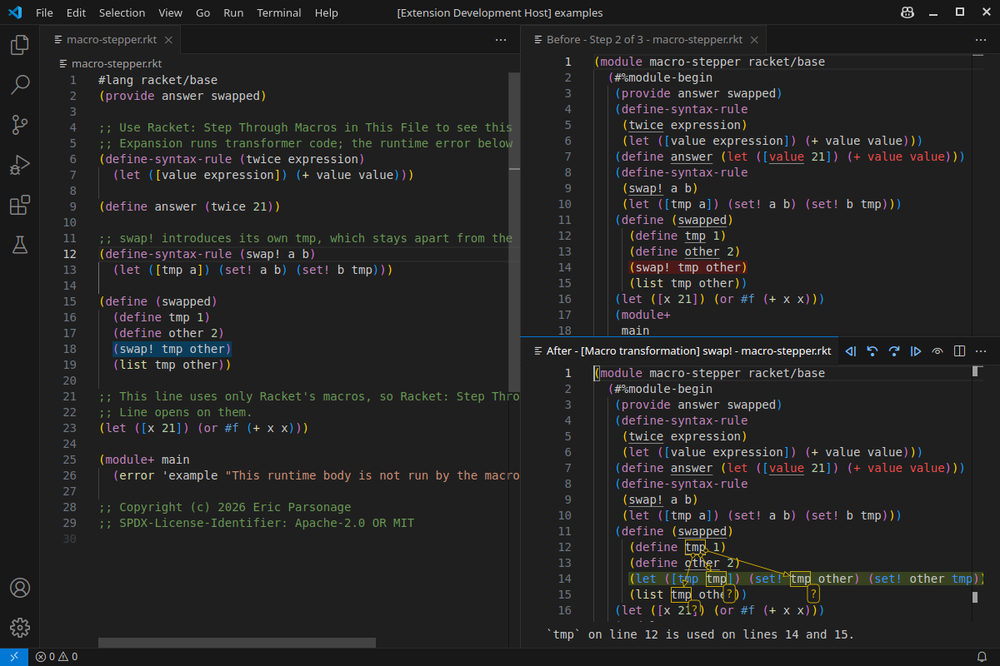
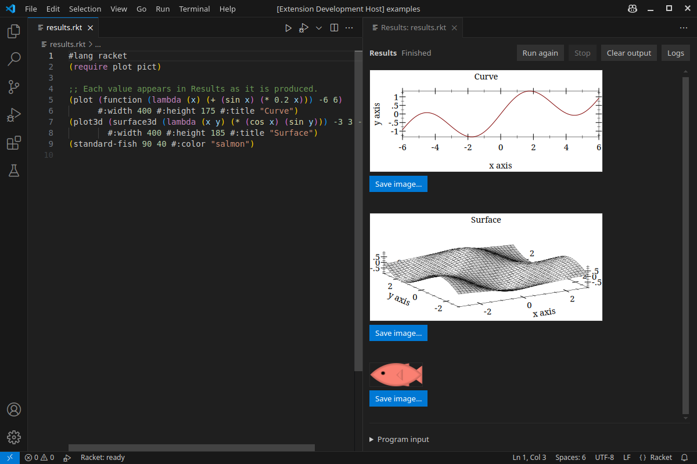
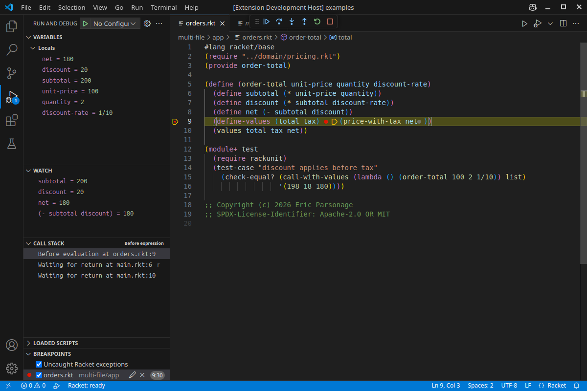
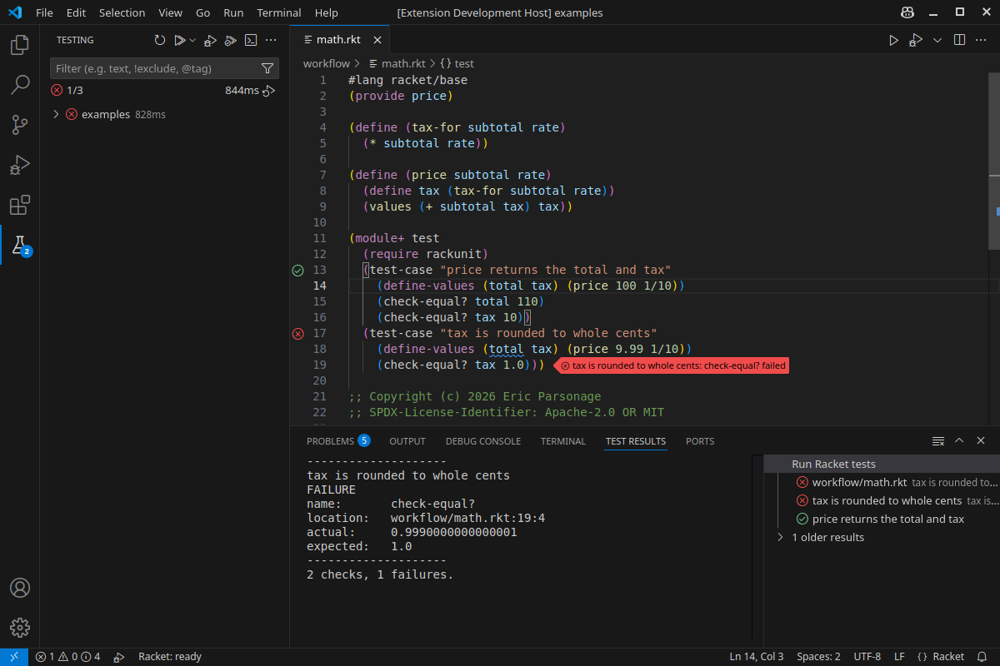

# Racketeer: Organised Racket

Racketeer brings macro stepping, workspace navigation, debugger attachment and rich results to Racket development in VS Code and VSCodium.

- **Macro stepping inside VS Code:** follow expansion in linked Before and After panes beside the source, with syntax colouring, scope colours, binding arrows and term details.
- **Vastly improved workspace indexing:** find references and rename across files, including unopened modules. On a measured 53-file project, indexing fell from **97.9 s to 8.9 s with one worker**, and from **37.0 s to 5.3 s with three workers**, with identical results. The index runs on request and reanalyses only files whose text or dependencies changed on later passes while the window stays open.
- **Attach the debugger to a running Racket program:** inspect servers and jobs started outside the editor. The program must embed Racketeer's debug host; disconnecting leaves the host running.
- **Language and debugging servers included:** Racketeer provides a language server and a workspace indexing server over the Language Server Protocol (LSP), and a debug adapter over the Debug Adapter Protocol (DAP).
- **Debug expressions:** set line and inline breakpoints, step across files and chosen packages, and inspect or change live values.
- **See results beside the code:** display text, images, picts and plots in Results or Interactions; zoom and rotate plots during debugging.
- **Test in Test Explorer:** run, debug or measure coverage, with individual RackUnit cases available in supported modules and suites.
- **Navigate, edit and experiment:** use hover documentation, completion, go to definition, live diagnostics and formatting, plus an Interactions window or a terminal REPL.
- **Package and build:** manage Racket packages and create launchers, executables and distributions.
- **Edit WXME and Rhombus:** edit WXME documents with embedded boxes, and Rhombus with the separate `rhombus` package.



Indexing measurements: [0.8.55 release record](docs/releases/0.8.55.md#measured-gains). These figures describe the measured project; timings vary with the workload.

## Install and try it

Requires **VS Code or VSCodium 1.91 or newer** and the **full Racket 9.1 or newer distribution**. The language servers and debug adapter are included. Resyntax suggestions are optional and need the separate `resyntax` package. Interactive plots and the WXME editor need a graphical display.

Install [Racket](https://download.racket-lang.org/) and put it on PATH or set `racketdap.racketExecutable`.

Install **Racketeer** from the Extensions view: VS Code installs it from the [Visual Studio Marketplace](https://marketplace.visualstudio.com/items?itemName=lamestllama.racketeer), and VSCodium from [Open VSX](https://open-vsx.org/extension/lamestllama/racketeer). Or build `dist/racketeer-0.8.55.vsix` as described under [Build and test](#build-and-test) and choose **Extensions: Install from VSIX…**. From a terminal:

```sh
code --install-extension dist/racketeer-0.8.55.vsix
```

Open a trusted folder and a saved `.rkt` file: the language tools start automatically. Click the play icon at the top right of the editor to see its Results, or the debug icon beside it to stop and inspect it.

The extension ID is `lamestllama.racketeer`; the debugger type and settings prefix are `racketdap`. See [installation troubleshooting](docs/workflows.md#installation-troubleshooting) before replacing the earlier development extension. While Magic Racket's language server is enabled, the status bar shows **Racket: external LSP**, and Racketeer's language tools and workspace index stay off. Disable that server and reload, or accept **Use Racketeer’s Tools**.

## Expand macros

Use **Racket: Step Through Macros on This Line** (**Alt+Shift+M**) or **Racket: Step Through Macros in This File** to open linked Before and After panes. Expansion uses unsaved text and runs compile-time code in a trusted workspace. See [the macro-stepper guide](docs/editor-tools.md#macro-stepper).

## Find and rename across a project

**Find All References** and **Rename Symbol** include unopened workspace modules. The index runs on request and reanalyses files whose text or dependencies changed. Defaults allow 1,000 files, 1 MiB per file and 16 MiB total; rename refuses incomplete or stale results. See [workspace references](docs/editor-tools.md#workspace-references) for settings and exclusions.

## Attach to a running program

Attach to a running Racket program that embeds Racketeer's debug host; disconnecting leaves the host running. See [the attachment configuration and host requirements](docs/debugger.md#attach-to-an-embedded-racket-program).

## Run a file and see its results

Use **Racket: Run Current File** to save and run the file, showing text and images in Results beside the source.



See [Results controls and lifetime](docs/workflows.md#results-view) and [images and plots](docs/workflows.md#images-and-plots) for input, saving and interactive plot controls.

## Debug with breakpoints

Use **Racket: Debug Current File** to stop and inspect a program with line and inline breakpoints, Call Stack and Variables.



Try [examples/demo.rkt](examples/demo.rkt) from the repository: place a breakpoint on line 4, evaluate `(+ subtotal 20)` in the Debug Console, then `(set! subtotal 200)`. Step Over displays `20` in the Return values scope; continuing prints `220` and `20`.

See [breakpoints](docs/debugger.md#breakpoints), [expression stepping](docs/stepping.md) and [evaluation and values](docs/debugger.md#evaluation-and-values).

## Test

Use **Racket: Test Current File** or the Testing view to run, debug or measure coverage, including individual RackUnit cases in supported modules and suites.



See [test discovery and reporting](docs/workflows.md#test-discovery-and-reporting) for settings, case discovery and coverage limits.

## Read more

- [The Marketplace page](vscode/README.md) introduces the workflows and links to their command and setting references. The guide starts with [execution](docs/workflows.md), [editing](docs/editor-tools.md) and [debugging](docs/debugger.md).
- [Understanding the stops](docs/stepping.md) walks through the initial stop and why an expression can stay highlighted after a step.
- [Debugger features](docs/debugger.md) records what the debugger does and how it is tested, and [attaching to an embedded program](docs/debugger.md#attach-to-an-embedded-racket-program).
- [Run, Debug, Test and REPL execution](docs/workflows.md), [editing and macro expansion](docs/editor-tools.md), [package development](docs/packages.md), [building applications](docs/application-builds.md), [module dependencies](docs/module-dependencies.md) and [WXME editing](docs/wxme-editor.md) give the details.
- Examples: [multi-file](examples/multi-file/README.md) follows four calls through nested folders, [workflow](examples/workflow/main.rkt) connects two source files, tests and the Debug REPL, and [packages](examples/packages/README.md) shows a linked package.

Limits on what is offered are stated in [the extension guide](vscode/README.md#limits). The [release quality requirements](docs/quality.md) and [0.8.55 validation record](docs/releases/0.8.55.md) state what has been checked and what is still needed.

## Build and test

Node.js 20 or newer is needed to build the extension and run the protocol tests. After `npm ci`, packaging works offline.

```sh
npm ci --prefix vscode
node scripts/package-extension.js
node scripts/test-headless.js
```

On Linux, with Python 3 and Xvfb available, run the native GUI checks and test the packaged VSIX in an isolated VS Code profile:

```sh
python3 scripts/test-gui.py
python3 scripts/test-vscode.py --artifact dist/racketeer-0.8.55.vsix
python3 scripts/test-vscode.py --rhombus --artifact dist/racketeer-0.8.55.vsix
python3 scripts/test-vscode.py --dogfood --artifact dist/racketeer-0.8.55.vsix
```

The extension tests itself. Open this repository in VS Code with the extension installed, open **Testing**, and select **Run All Tests**. Set a breakpoint in a test and select **Debug Test** to inspect it.

Continuous integration runs the core and the installed extension on Linux x64 at every push, with the minimum and newest VS Code, and on Windows x64 and macOS ARM64 on demand. It uses Racket 9.1 and Racket's stable release, except that the installed extension on Windows and macOS uses 9.1 alone.

Details: [the test workflow](tests/README.md), and [continuous integration and local checks](docs/ci.md).

## Layout

| Path | What is there |
| --- | --- |
| `racketdap/` | The debug adapter, its worker and the [instrumentation](racketdap/instrumentation/DESIGN.md). |
| `vscode/` | The extension client, language-server launcher and manifest. |
| `vendor/` | Bundled language-server sources, patches and notices: see [vendor/README.md](vendor/README.md). |
| `tests/` | RackUnit and Node suites, helpers and fixtures. |
| `scripts/` | Packaging and test harnesses. |
| `examples/` | Programs to try each feature on. |
| `experiments/` | The headless demonstration and the lexical evaluator. |
| `docs/` | Feature details, quality requirements and release records. |

[DESIGN.md](DESIGN.md) records the longer-term architecture and acceptance plan; its delivery gates include work beyond this release. [How the pieces connect](docs/debugger.md#how-the-pieces-connect) gives the process structure.

By [Eric Parsonage](https://github.com/lamestllama).

## Licence

Copyright © 2026 Eric Parsonage. Racketeer's original code, examples, tests and documentation are available under [Apache-2.0 OR MIT](LICENSE), at the licensee's choice. Bundled dependencies retain their own copyright and licence notices: see [vendor/README.md](vendor/README.md).
