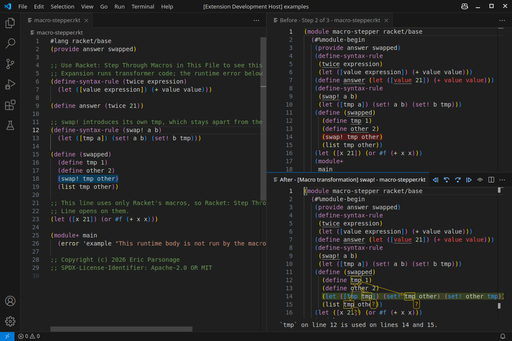
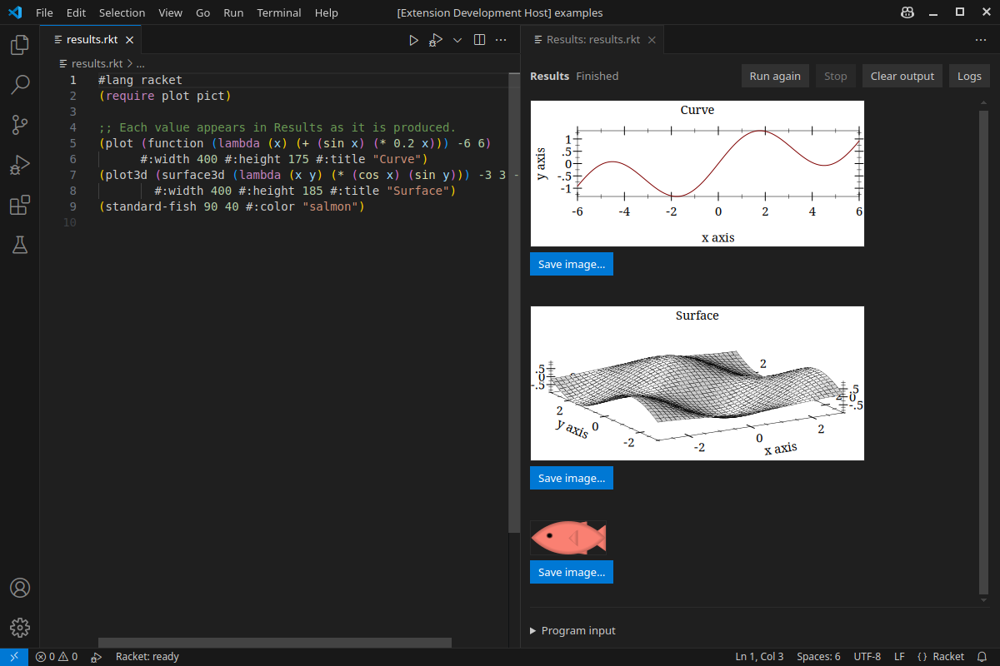
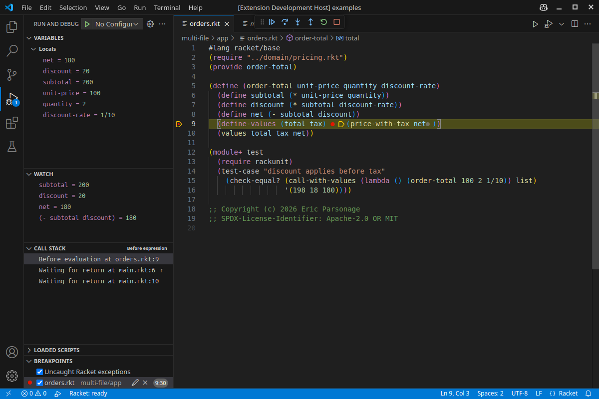
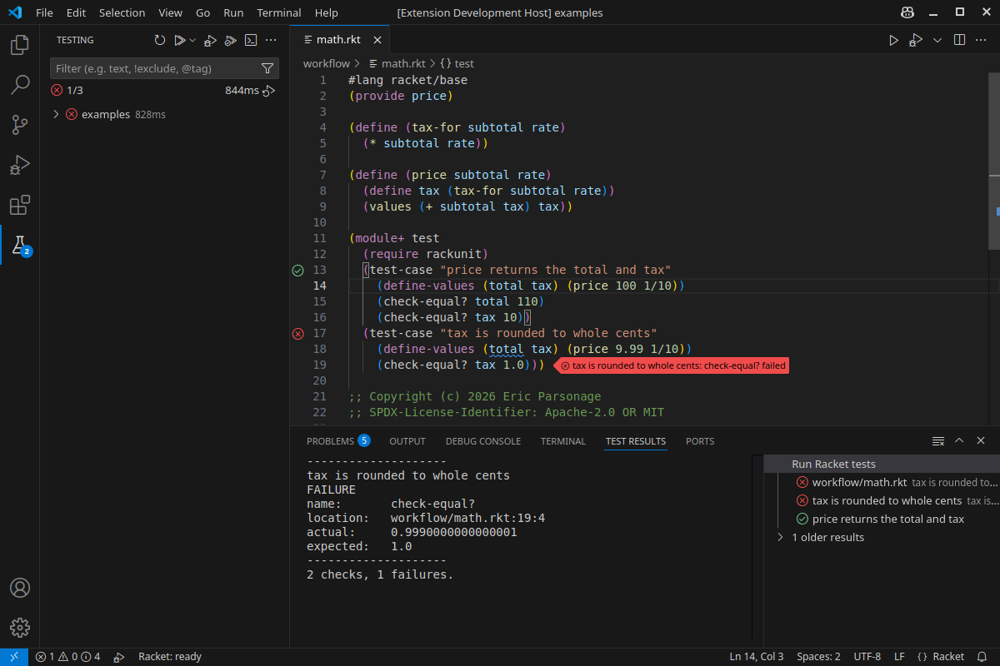

# Racketeer: Organised Racket

Racketeer brings macro stepping, workspace navigation, debugger attachment and rich results to Racket development in VS Code and VSCodium.

- **Macro stepping inside VS Code:** follow expansion in linked Before and After panes beside the source, with syntax colouring, scope colours, binding arrows and term details.
- **Vastly improved workspace indexing:** find references and rename across files, including unopened modules. On a measured 53-file project, indexing fell from **97.9 s to 8.9 s with one worker**, and from **37.0 s to 5.3 s with three workers**, with identical results. The index runs on request and reanalyses only files whose text or dependencies changed on later passes while the window stays open.
- **Attach the debugger to a running Racket program:** inspect servers and jobs started outside the editor. The program must embed Racketeer's debug host; disconnecting leaves the host running.
- **Language and debugging servers included:** Racketeer provides a language server and a workspace indexing server over the Language Server Protocol (LSP), and a debug adapter over the Debug Adapter Protocol (DAP).
- **Debug expressions:** set line and inline breakpoints, step across files and chosen packages, and inspect or change live values.
- **See results beside the code:** display text, images, picts and plots in Results or Interactions; zoom and rotate plots during debugging.
- **Test in Test Explorer:** run, debug or measure coverage, with individual RackUnit cases available in supported modules and suites.
- **Navigate, edit and experiment:** use hover documentation, completion, go to definition, live diagnostics and formatting, plus an Interactions window or a terminal REPL.
- **Package and build:** manage Racket packages and create launchers, executables and distributions.
- **Edit WXME and Rhombus:** edit WXME documents with embedded boxes, and Rhombus with the separate `rhombus` package.



Indexing measurements: [0.8.55 release record](https://github.com/lamestllama/racketeer/blob/main/docs/releases/0.8.55.md#measured-gains). These figures describe the measured project; timings vary with the workload.

## Install and start

Requires **VS Code or VSCodium 1.91 or newer** and the **full Racket 9.1 or newer distribution**. The language servers and debug adapter are included.

1. Install [Racket](https://download.racket-lang.org/) and put it on PATH, or set `racketdap.racketExecutable` in Settings.
2. Install **Racketeer** from the Extensions view: [Visual Studio Marketplace](https://marketplace.visualstudio.com/items?itemName=lamestllama.racketeer) for VS Code, or [Open VSX](https://open-vsx.org/extension/lamestllama/racketeer) for VSCodium.
3. Open a trusted folder and a saved `.rkt` file. Wait for **Racket: ready** in the status bar.
4. Select the editor's play icon to run the file and open Results, or the debug icon to stop and inspect it.

Resyntax suggestions are optional and need the separate `resyntax` package. Interactive plots and the WXME editor need a graphical display.

If the status bar shows **Racket: external LSP**, select **Use Racketeer’s Tools** or disable Magic Racket's language server and reload to enable Racketeer's language tools and workspace index.

For version errors, installing a VSIX or replacing the earlier development extension, see [installation troubleshooting](https://github.com/lamestllama/racketeer/blob/main/docs/workflows.md#installation-troubleshooting). The [release record](https://github.com/lamestllama/racketeer/blob/main/docs/releases/0.8.55.md#platform-coverage) records platform coverage.

## Expand macros

Open linked **Before** and **After** panes beside the source, with scope colours, binding arrows and term details. Choose which macros appear, or duplicate the stepper to compare expansions independently.

Use **Racket: Step Through Macros on This Line** (**Alt+Shift+M**) for the current line or selection, or **Racket: Step Through Macros in This File** for the whole file. Both use unsaved buffer text without saving it. Try [the macro example](https://github.com/lamestllama/racketeer/blob/main/examples/macro-stepper.rkt).

Expansion runs readers and compile-time code and requires a trusted workspace. It does not run the module's ordinary body. A graphical display is not required.

The [macro-stepper guide](https://github.com/lamestllama/racketeer/blob/main/docs/editor-tools.md#macro-stepper) covers navigation, display and hiding options, worker lifetime, limits and error controls.

## Find and rename across a project

**Find All References** and **Rename Symbol** (F2) include unopened `.rkt`, `.ss`, `.scm` and `.scrbl` modules in a trusted workspace. The index runs on request; the first request after a change waits for a cancellable pass. While the window stays open, later passes reanalyse only files whose text or dependencies changed. Unsaved buffers supply their files' text.

The defaults allow **1,000 files**, **1 MiB per file** and **16 MiB total**. The status bar reports progress and partial references. Rename requires a complete, current index and refuses incomplete or stale results. Excluded folders and unscanned file types remain outside a rename, so check those callers separately; default exclusions include `build` and `dist`.

Use **Racket: Refresh Workspace References** after external package changes or to retry a failed analysis. See the [measured indexing gains](https://github.com/lamestllama/racketeer/blob/main/docs/releases/0.8.55.md#measured-gains), [workspace-reference settings and limits](https://github.com/lamestllama/racketeer/blob/main/docs/editor-tools.md#workspace-references) and [rename rules](https://github.com/lamestllama/racketeer/blob/main/docs/editor-tools.md#rename-across-files).

## Attach to a running program

Attach the debugger to a running Racket program that embeds the debug host.
This suits servers, long-running jobs and programs started outside the editor.

The host loads `racketdap/worker/attach.rkt` and supplies a loopback port and a
secret token. Connect with a `racketdap` configuration in `launch.json`:

```json
{
  "type": "racketdap",
  "request": "attach",
  "name": "Attach to Racket host",
  "port": 49152,
  "token": "replace-with-the-host-token"
}
```

Use the port and token returned by the host. No `program` is required.
Breakpoints, stepping, source selection and inspection use the embedded debug
host. Code must be instrumented through that host; an arbitrary Racket process
cannot be attached. Disconnect and Stop release debugger stops and leave the
host running. Input, output and thread lifetime stay with the host.

Details: [Attaching to an embedded Racket program](https://github.com/lamestllama/racketeer/blob/main/docs/debugger.md#attach-to-an-embedded-racket-program).

## Run a file and see its results

Use **Racket: Run Current File** to save the file, run its root module and `main` submodule when present, and show text and images in **Results** beside the source. Results stays open after the program exits.



The editor toolbar also offers **Racket: Debug Current File** and **Racket: File Actions…**. Use **Racket: Run Current File in Terminal** for terminal applications and native process streams.

See [Results controls, input and lifetime](https://github.com/lamestllama/racketeer/blob/main/docs/workflows.md#results-view), and [images and plots](https://github.com/lamestllama/racketeer/blob/main/docs/workflows.md#images-and-plots) for printing rules, image saving and interactive plot controls.

## Debug with breakpoints

Stop on a line or at an expression within it, across workspace files and chosen packages, and inspect the program's state.



Run **Racket: Debug Current File**, then select the gutter beside a line number or press **F9** to add a breakpoint. Right-click it to add a condition, hit count or log message. **Racket: Continue to Cursor** runs to one chosen point.

Uncaught runtime exceptions stop by default so their details, lexical variables and Call Stack can be inspected. Choose **Continue** to let the same exception propagate.

See [breakpoints](https://github.com/lamestllama/racketeer/blob/main/docs/debugger.md#breakpoints) for binding rules and edge cases, and [uncaught exceptions](https://github.com/lamestllama/racketeer/blob/main/docs/debugger.md#uncaught-exceptions) for exception behaviour.

## Step through expressions

Use **Step Into** (F11), **Step Over** (F10), **Step Out** (Shift+F11) and **Continue** (F5). Stops show both expression starts and returned values; open **Return values** in Variables after a return.

By default a launch stops in `main`, the selected submodule or the module body. See [Understanding the stops](https://github.com/lamestllama/racketeer/blob/main/docs/stepping.md) for entry modes, tail calls, source markers and stepping limits.

## Inspect and change values

Select a frame in **Call Stack**, then expand **Variables → Locals**, hover a variable, or evaluate Racket in the **Debug Console** or **Watch**. For example: `(+ subtotal 20)` or `(set! subtotal 200)`.

**Racket: Set Variable Value** changes the variable under the cursor in the selected frame. Evaluation and assignment take real effect. See [evaluation and values](https://github.com/lamestllama/racketeer/blob/main/docs/debugger.md#evaluation-and-values) for expression replacement, printing, cancellation and inspection boundaries.

## Save a launch configuration

Use **Add Configuration** in `launch.json` to save a program's arguments, environment, console, entry behaviour and source selection.

See [launching a program](https://github.com/lamestllama/racketeer/blob/main/docs/debugger.md#launching-a-program) for an example and the attribute reference, and [compiled code](https://github.com/lamestllama/racketeer/blob/main/docs/debugger.md#compiled-code) for cache settings and external-file dependencies.

## Test

VS Code's **Testing** view discovers workspace `.rkt` files without executing them. Run, debug or measure coverage for a file, folder or all discovered files, with individual RackUnit cases in supported modules and suites.



Start with **Racket: Test Current File**, or choose **Run Tests with Coverage** in the Testing view. Results include check counts, output and clickable failure locations. **Racket: Debug Tests in Current File** adds breakpoints and stepping.

See [test discovery and reporting](https://github.com/lamestllama/racketeer/blob/main/docs/workflows.md#test-discovery-and-reporting) for supported case discovery, settings, teaching-language checks, package policies and coverage limits.

## Navigate and edit

The bundled [racket-langserver](https://github.com/jeapostrophe/racket-langserver) provides completion, hover documentation, go to definition, references, rename, live diagnostics, symbols, semantic highlighting, signature help, inlay hints and code actions. Support varies with the program's `#lang` and available documentation. Formatting uses bundled `fixw`, with language-specific indentation available as an option.

Use **Racket: Show Language Server Output** to see analysis messages, or **Racket: Restart Language Server** to restart the tools. Press **Alt+\\** (**Option+\\** on macOS) to insert `λ` in an editable Racket buffer.

See [language-server settings and limits](https://github.com/lamestllama/racketeer/blob/main/docs/editor-tools.md#language-server), [tail positions and imports](https://github.com/lamestllama/racketeer/blob/main/docs/editor-tools.md#tail-positions-and-imports), [new documents before saving](https://github.com/lamestllama/racketeer/blob/main/docs/editor-tools.md#new-documents-before-saving) and [lambda insertion](https://github.com/lamestllama/racketeer/blob/main/docs/editor-tools.md#lambda-insertion).

## Work interactively

Use **Racket: Run in Interactions** to load the saved root module and evaluate expressions beside the source, with pictures inline and errors linked to their source. **Racket: Evaluate Selection in Debug REPL** (Shift+Enter) sends selected complete expressions to that file's session; calls can hit breakpoints. These commands do not run `main` or `test`.

For an ordinary terminal REPL, use **Racket: Start REPL** and **Racket: Load Current File in REPL**.

See [Interactions and the Debug REPL](https://github.com/lamestllama/racketeer/blob/main/docs/workflows.md#interactions-and-the-debug-repl) for commands, controls, session lifetime and examples, and [REPL terminals](https://github.com/lamestllama/racketeer/blob/main/docs/workflows.md#repl-terminals) for file and workspace sessions.

## Manage packages

Use **Racket: Manage Packages** to install, link, update, remove, build or test packages, or open their source. **Racket: Choose Packages to Debug** includes selected package sources in future debug sessions.

See [package development](https://github.com/lamestllama/racketeer/blob/main/docs/packages.md) for commands, scope, cancellation and settings, and the [linked-package example](https://github.com/lamestllama/racketeer/blob/main/examples/packages/README.md).

## Build applications

Use **Racket: Create Launcher…**, **Racket: Build Executable…** or **Racket: Create Distribution…** to create a launcher, embedded executable or directory of runtime dependencies.

See [building applications](https://github.com/lamestllama/racketeer/blob/main/docs/application-builds.md) for Console and GUI builds, repeatable tasks, target compatibility and data files, and try [the application examples](https://github.com/lamestllama/racketeer/tree/main/examples/application).

## Read a program's logs

Use **Racket: Show Application Log**, or **Logs** in Interactions, to see messages filtered by level and topic in the Output panel. The default filter is `error`.

See [application logs](https://github.com/lamestllama/racketeer/blob/main/docs/workflows.md#application-logs) for filter syntax, commands, settings and retention. Try [the logging example](https://github.com/lamestllama/racketeer/blob/main/examples/logging.rkt).

## Browse module dependencies

Use **Racket: Browse Module Dependencies** on a named source file to follow its imports and phases in the **Racket Dependencies** tree.

See [module dependencies](https://github.com/lamestllama/racketeer/blob/main/docs/module-dependencies.md) for navigation, refresh, unsaved buffers, trusted compilation and size limits.

## Edit Rhombus

Open a `.rhm` file for Rhombus highlighting, comments, brackets and indentation. For semantic analysis, install the `rhombus` package in the Racket environment selected by `racketdap.racketExecutable`; **Racket: Install Package** can do this, and `rhombus-lib` supplies the language without documentation. Racketeer does not bundle or install the language.

**Good to know:** Rhombus support covers editing and has no debugging: source debugging, the Debug REPL and the Testing view are not established for it. Automatic formatting is off, because the bundled default formatter handles Racket S-expressions.

Details: [Rhombus](https://github.com/lamestllama/racketeer/blob/main/docs/editor-tools.md#rhombus).

## Read and edit WXME documents

Choose **Open With** on a saved WXME file. **Racketeer WXME Viewer** reads text and embedded bitmap images without running the program. **Racketeer WXME Editor** also edits text and supported embedded boxes, with a graphical display and the full Racket installation.

See [the viewer and editor guide](https://github.com/lamestllama/racketeer/blob/main/docs/wxme-editor.md#viewer-and-editor) for supported objects, saving, source debugging and limits.

## Limits

- Debugging covers runtime expressions in instrumented source; macro-time stepping, reverse execution and tracing caught exceptions are unavailable. See [debugger scope and restrictions](https://github.com/lamestllama/racketeer/blob/main/docs/debugger.md#threads-pause-and-what-is-instrumented).
- Language analysis, macro expansion and dependency browsing execute readers and compile-time code and require a trusted workspace.
- Attachment requires an embedded debug host, and project rename requires a complete, current index within its configured scope.

For tested languages and platform coverage, see [debugger features](https://github.com/lamestllama/racketeer/blob/main/docs/debugger.md) and the [0.8.55 release record](https://github.com/lamestllama/racketeer/blob/main/docs/releases/0.8.55.md). [Installation troubleshooting](https://github.com/lamestllama/racketeer/blob/main/docs/workflows.md#installation-troubleshooting) covers version refusals.

By [Eric Parsonage](https://github.com/lamestllama).

## Licence

Copyright © 2026 Eric Parsonage. Racketeer's original code and documentation are licensed under Apache-2.0 OR MIT, at the licensee's option. The extension includes `LICENSE`, `LICENSE-APACHE`, `LICENSE-MIT` and `COPYRIGHT`. Bundled dependencies keep their own copyright and licence notices: `language-server/` holds the bundled language-server sources, archive hashes and notices, and `out/THIRD_PARTY_NOTICES.txt` the JavaScript dependency notices.
